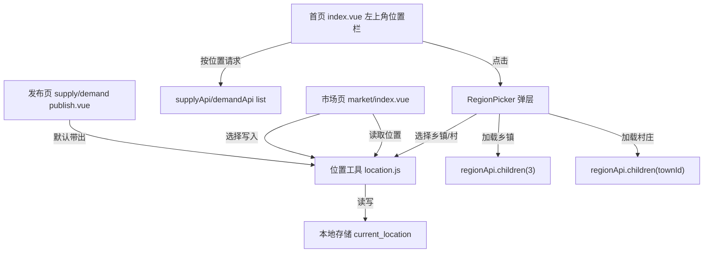

# 位置切换功能技术设计

Feature Name: 2026-10-12-location-switcher
Updated: 2026-10-12

## Description

在客户端引入「当前位置（乡镇/村）」的全局概念，参考美团左上角体验：位置入口位于首页左上角，可切换、可持久化，并联动首页、市场列表与发布表单。位置数据完全复用后端既有 `sys_region` 行政层级接口（`GET /api/regions/children?parentId=3`），不引入 GPS、经纬度或地图能力，后端无新增接口与表结构变更。

## Architecture

## Components and Interfaces

### 1. 位置工具 `frontend/src/utils/location.js`（新增）

- `getLocation(): { countyId, townId, townName, villageId, villageName } | null`
  读取本地存储 `current_location`，无有效乡镇时返回 `null`。
- `setLocation(loc): void`
  写入本地存储；`loc` 无 `townId` 时清除。
- `getTownLabel(loc): string`
  返回 `loc?.townName || '全部乡镇'`。
- `sameLocation(a, b): boolean`
  比较乡镇与村是否一致，供市场页判重。

存储键：`current_location`，值形如 `{ countyId: 3, townId: 12, townName: '谯楼街道', villageId: null, villageName: '' }`。

### 2. 区域选择组件 `frontend/src/components/region-picker.vue`（增强）

- 新增 prop：`allowAll: Boolean = false`。
- 当 `allowAll` 为真，乡镇列表首项渲染「全部乡镇」选项；点击后 `$emit('town-change', { townId: null, townName: '' })` 并关闭。
- 保持既有 `update:townId` / `update:villageId` / `town-change` / `village-change` 事件契约不变，向后兼容市场页与发布页。

### 3. 首页 `frontend/src/pages/index/index.vue`（修改）

- hero 顶部新增位置栏：`📍 {{ townLabel }} ▾`，`@tap` 打开 `RegionPicker`（`allowAll`）。
- `onShow` 读取 `getLocation()` 同步 `townLabel` 与 `townId`；`load()` 在存在 `townId` 时附加 `{ townId, townIncludeVillages: true }`。
- 选择事件：`setLocation` + 刷新列表。
- 首屏加载候选数据：供应 `pageSize 5`、采购 `pageSize 4`（沿用现网）。

### 4. 市场页 `frontend/src/pages/market/index.vue`（修改）

- `onLoad`：以 `getLocation()` 初始化 `townId/villageId/townLabel`。
- `onShow`：读取最新位置，与当前筛选不一致时应用并 `reload()`（满足「首页切换后返回市场生效」）。
- RegionPicker 传 `allowAll`；`onTownChange` 写入 `setLocation`（乡镇为空则清除）。

### 5. 发布页 `frontend/src/pages/supply/publish.vue` 与 `demand/publish.vue`（修改）

- 仅在新建模式（`!editId`）且本地存在位置时，预填 `countyId/townId/villageId` 与 `regionLabel`。
- 编辑模式保持既有回填逻辑，不被覆盖。

## Data Models

客户端存储（`uni.setStorageSync('current_location', loc)`）：

| 字段 | 类型 | 说明 |
|------|------|------|
| countyId | number | 县区 id，固定 3（息县） |
| townId | number \| null | 乡镇 id |
| townName | string | 乡镇名称，用于展示 |
| villageId | number \| null | 村 id（可空） |
| villageName | string | 村名称（可空） |

后端无变更。

## Correctness Properties

1. `getLocation()` 仅在 `townId` 有效时返回对象，否则返回 `null`，保证「全部乡镇」语义一致。
2. 位置展示名称与 `townId` 始终同源，避免出现标签与筛选不一致。
3. 编辑既有发布时产地/交货地不被位置预填覆盖。
4. RegionPicker 事件契约不变，市场页与发布页既有行为不回退。

## Error Handling

- 本地存储读写异常被捕获并降级为「全部乡镇」，不阻断页面渲染。
- `regionApi.children` 失败时，RegionPicker 展示为空列表，沿用现有失败静默行为。
- 位置中乡镇已被停用导致列表查询为空时，页面正常展示「暂无数据」。

## Test Strategy

- 前端 `npm run build:h5` 与 `npm run build:mp-weixin` 构建通过作为基础门槛。
- 手动回归路径（H5 预览）：
  1. 首页左上角默认显示「全部乡镇」，点击可切换乡镇，切换后列表数量变化。
  2. 切换后进入市场页，筛选标签与列表与首页一致。
  3. 在市场页选择「全部乡镇」，返回首页显示同步。
  4. 进入发布供应/采购页，产地/交货地默认带出当前乡镇。
  5. 编辑既有发布，产地/交货地保持原值。
- 后端集成测试不受影响（无后端改动）。

## References

[^1]: (File) - 区域选择组件 [region-picker.vue](../../frontend/src/components/region-picker.vue)
[^2]: (File) - 区域接口 [RegionController.cs](../../backend/AgroMarket.Api/Controllers/RegionController.cs)
[^3]: (File) - 市场列表 [market/index.vue](../../frontend/src/pages/market/index.vue)
