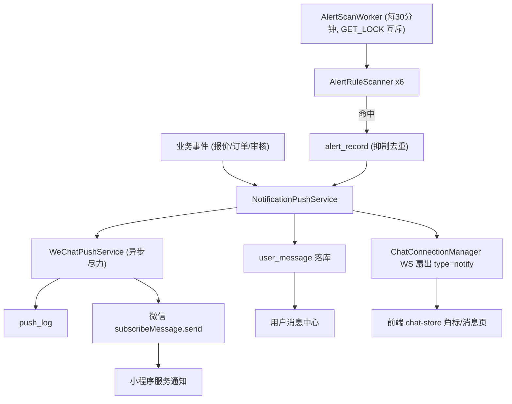

# 技术设计: 消息推送与报警

Feature Name: message-push-alert
Updated: 2026-10-13
Requirements: ./requirements.md

## Description

在现有站内消息（`user_message`）与聊天 WebSocket（`/ws/chat`）基础上增加三块能力：

1. **NotificationPushService**：统一推送门面——落库 `user_message`（新增 `ALERT` 类型）→ WS 在线扇出 `{type:"notify"}` 帧 → 按模板配置异步发微信订阅消息。
2. **WeChatPushService**：access_token 缓存 + `subscribeMessage.send`，未配置 `WeChat:*` 时整体降级关闭（与 Ai 模块 IsConfigured 模式一致，不伪造结果）。
3. **AlertScanWorker**：常驻后台扫描，执行 `alert_rule` 中启用的规则 → 命中写 `alert_record`（抑制窗口内去重）→ 经 NotificationPushService 通知接收人。

## Architecture



## Components and Interfaces

### 1. NotificationPushService（`backend/AgroMarket.Api/Notifications/`）

```
Task NotifyAsync(long receiverId, string msgType, string title, string? content, long? bizId)
Task NotifyAdminsAsync(string msgType, string title, string? content, long? bizId)  // 查询全部 ACTIVE ADMIN
```

- 落库 `user_message`（复用 MessageService.SendAsync，失败不抛）。
- WS 扇出：`ChatConnectionManager` 按 userId 取全部连接，发送 `{type:"notify", messageId, msgType, title, bizId, createdAt}`；异常吞掉。
- 微信：后台队列式 fire-and-forget（Task.Run + 静态 SemaphoreSlim 限并发 4），失败记 `push_log.status='FAILED'`。

### 2. WeChatPushService

- 配置 `WeChat:AppId/AppSecret/Templates:{QUOTE,ORDER,AUDIT}`；`IsConfigured=false` 时所有发送直接跳过。
- access_token 内存缓存（提前 5 分钟刷新）；并发刷新用 `SemaphoreSlim(1,1)` 防击穿。
- 订阅额度在微信侧消耗：发送返回 43101（用户未订阅）时记 `UNSUBSCRIBED` 并将用户该模板计数清零（`wx_subscribe_quota` 表）。

### 3. AlertScanWorker（BackgroundService，风格同 FederationSyncWorker）

- 启动延迟 30~60s 随机；周期 `alert_scan_interval_minutes`（内存缓存，热生效）；每轮 `GET_LOCK('alert_scan',0)` 取不到跳过。
- 日级规则（成交波动/联动 stale）用 `alert_record` 最后日级记录时间判定是否已执行。
- 六个规则扫描器，均单条 SQL：

| code | 查询 | 默认阈值 | 接收人 |
|---|---|---|---|
| ORDER_PAY_TIMEOUT | trade_order WHERE status='TO_PAY' AND created_at < NOW()-interval | 24h | 买卖双方+ADMIN |
| QUOTE_NO_RESPONSE | trade_quote WHERE status='PENDING' AND created_at < NOW()-interval | 48h | 双方+ADMIN |
| LISTING_EXPIRED | product_supply/purchase_demand WHERE status='ACTIVE' AND expire_at<NOW() | 即时 | 发布者 |
| AUDIT_BACKLOG | COUNT(status='PENDING') 供需合计 > n | 20 | ADMIN |
| TRADE_ANOMALY | 当日真实成交额 vs 前7日日均 (复用 DashboardService 真实成交口径) | ±50% | ADMIN |
| FED_SYNC_STALE | fed_node.last_success_at < NOW()-HealthStaleMinutes | 复用现有 | ADMIN |

- 抑制：`alert_record` 唯一键 `(rule_code, object_id)`，存在且 `created_at > NOW()-suppress_hours` 则跳过发送（只更新 `hit_count`）。
- 恢复通知：FED_SYNC_STALE 命中对象在抑制期内恢复正常 → 写 `alert_record(resolved_at)` 并发恢复通知。

### 4. 管理端接口（AdminController 或独立 AlertController）

- `GET api/admin/alerts/rules` → 规则列表（含 enabled/阈值/抑制窗口）
- `PUT api/admin/alerts/rules/{code}` → 更新 enabled/threshold/suppressHours/recipientScope（白名单校验，400 保留原值）
- `GET api/admin/alerts/records?page=` → 报警记录分页
- 小程序端：`POST api/wechat/subscribe-report` 上报订阅授权结果（写 quota 计数）

## Data Models

迁移 `database/11_push_alert.sql`（幂等，动态 ALTER 风格同 10 号迁移）：

```sql
-- 报警规则 (内置 6 行, INSERT IGNORE)
alert_rule (
  code VARCHAR(40) PK, enabled TINYINT(1) DEFAULT 1,
  threshold_json VARCHAR(500),        -- {"hours":24} / {"count":20} / {"percent":50}
  suppress_hours INT DEFAULT 24,
  recipient_scope VARCHAR(20),        -- PARTY/PARTY_AND_ADMIN/ADMIN_ONLY/PUBLISHER
  updated_at DATETIME(3)
)

-- 报警记录
alert_record (
  id BIGINT PK AUTO_INCREMENT,
  rule_code VARCHAR(40), object_id BIGINT UNSIGNED,   -- 订单/报价/供需/节点 id; TRADE_ANOMALY 固定 0
  status VARCHAR(20) DEFAULT 'OPEN',   -- OPEN/RESOLVED/MUTED(抑制跳过)
  hit_count INT DEFAULT 1,
  detail VARCHAR(500), resolved_at DATETIME(3) NULL,
  created_at DATETIME(3),
  UNIQUE KEY uk_alert (rule_code, object_id),
  KEY idx_alert_created (created_at)
)

-- 推送日志
push_log (
  id BIGINT PK, message_id BIGINT UNSIGNED NULL, channel VARCHAR(20),  -- WECHAT/WS
  receiver_id BIGINT UNSIGNED, template_key VARCHAR(20) NULL,
  status VARCHAR(20),                   -- SENT/FAILED/UNSUBSCRIBED/SKIPPED
  error VARCHAR(500) NULL, created_at DATETIME(3),
  KEY idx_pl_receiver (receiver_id, created_at)
)

-- 小程序订阅额度计数
wx_subscribe_quota (
  user_id BIGINT UNSIGNED, template_key VARCHAR(20), quota INT DEFAULT 0, updated_at DATETIME(3),
  PRIMARY KEY (user_id, template_key)
)

-- user_message.msg_type 扩展枚举: SYSTEM/QUOTE/ORDER/REPORT + ALERT (列注释更新, 无需 DDL 变更)
```

### WS 通知帧（复用 /ws/chat 连接）

```json
{ "type": "notify", "messageId": 123, "msgType": "ALERT", "title": "订单支付超时", "bizId": 456, "createdAt": "..." }
```

前端 `chat-store.js` 新增 `notify` 帧处理：累加全局未读、触发消息页事件；ALERT 类型仅更新角标与消息页，不强弹（R7.3）。

## Correctness Properties

1. 任何报警必然先落 `alert_record` 再发消息；`(rule_code, object_id)` 在抑制窗口内至多一条 OPEN 记录产生一次消息。
2. 消息发送失败永不阻断业务主流程（NotificationPushService 全路径吞异常 + 日志）。
3. 多实例部署下同一时刻至多一个扫描在执行（GET_LOCK 互斥）。
4. 微信发送仅在有剩余订阅额度（wx_subscribe_quota.quota > 0）时尝试，发送成功即减 1。
5. 报警规则更新在下一次扫描生效，无需重启（阈值缓存随扫描轮失效）。

## Error Handling

| 场景 | 处理 |
|---|---|
| WS 连接中断 | 落库为准，客户端重连后按未读数接口补齐 |
| 微信 access_token 刷新失败 | 记 push_log FAILED，下轮重试；连续失败不告警循环（仅日志） |
| 微信 43101 未订阅 | quota 清零，记 UNSUBSCRIBED，之后跳过该用户该模板 |
| 单规则扫描 SQL 异常 | 捕获记日志，继续其余规则（R6.3） |
| 后台非法阈值 | 400 + 保留原值（R5.3） |
| WeChat 未配置 | WeChatPushService.IsConfigured=false，全链路 SKIPPED，站内消息不受影响 |

## Test Strategy

集成测试 `backend/AgroMarket.Tests` 新增段落（沿用 Call/Check 风格）：

1. **规则配置**：读默认规则列表（6 条）；改阈值非法返回 400；改合法阈值后 GET 生效；改回默认。
2. **抑制去重**：直接对 `alert_record` 造一条 1 小时前的 ORDER_PAY_TIMEOUT 记录（或触发 `POST api/admin/alerts/scan` 手动扫描接口），断言 24h 抑制窗口内不再产生新消息。
3. **手动扫描**：新增 `POST api/admin/alerts/scan`（管理员）触发一轮扫描，断言 AUDIT_BACKLOG / TRADE_ANOMALY 规则可执行且返回扫描摘要（各规则 hit 数）。
4. **ALERT 消息流转**：造 PENDING 超过阈值的报价→扫描→断言双方 user_message 出现 ALERT 类型 + alert_record OPEN。
5. **非管理员 403**：普通用户访问 alerts 接口。
6. **微信未配置降级**：WeChat 未配置时扫描不报错，push_log 无 WECHAT 行。

前端验证：H5 构建通过；ALERT 消息在消息中心显示警示样式；管理后台"报警中心"页列表/规则表单可交互（单测不可覆盖，构建+手测）。

## References

[^1]: backend/AgroMarket.Api/Federation/Application/FederationSyncWorker.cs — worker + GET_LOCK 模式复用
[^2]: backend/AgroMarket.Api/Chat/Realtime/ChatRealtimeHub.cs — WS 帧协议与连接管理
[^3]: backend/AgroMarket.Api/Services/MessageService.cs — 站内消息发送门面
[^4]: .monkeycode/specs/2026-10-13-message-push-alert/requirements.md — 本设计对应需求
